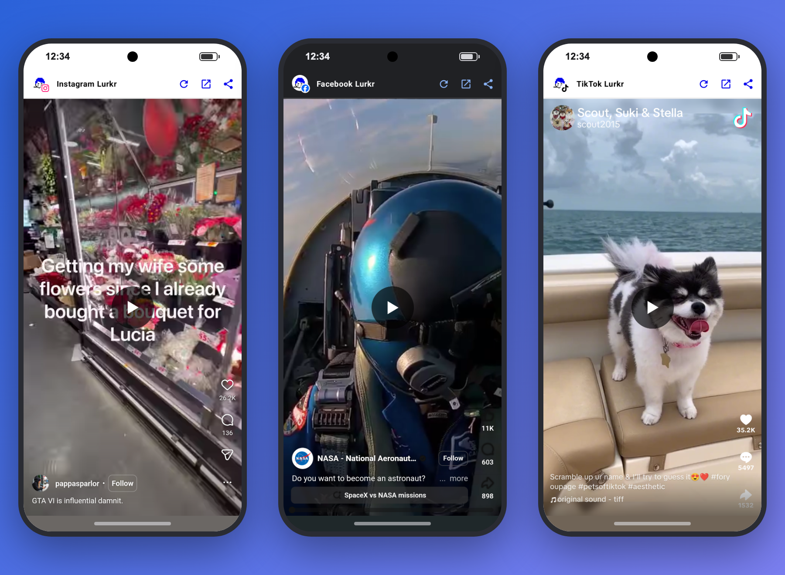

<p align="center"></p>

<h1 align="center">Lurkr</h1>

<h3 align="center">See any post. Skip the walls. Leave no trail.</h3>

<p align="center">Open links to social sites logged out: No login walls or app nags, the same simple video controls and dark mode on every site, and a brand-new visit every time, so nothing follows you around.</p>

<p align="center"></p>

A small Android app for the links people send you. Lurkr either **shows them itself**, logged out and without the login walls, "open in the app" prompts, cookie banners and popups, or **sends them to the app you choose** for that site. For example, Instagram and X in Lurkr, YouTube in NewPipe, everything else in your browser. No accounts, no ads, no analytics, no servers. Pages come straight from the site, and nothing they store survives the visit.

If you like this or find it useful, support the project by buying me a coffee.

<a href="https://www.buymeacoffee.com/antoniocosta"></a>

Lurkr has two sibling apps with the same look: [IPeekr](https://github.com/antoniocosta/IPeekr), a home-screen widget that shows your connection, and [Reedr](https://github.com/antoniocosta/Reedr), a readability app that shows any article as a clean page, right away.

## Why I made it

Friends keep sending me links to social sites I'm not on and have no plans to join. Open one of those without an account and you get a page that barely works: A login wall, a cookie banner, an "open the app" prompt, a video that won't play with sound. Meanwhile the site is busy working out who you are.

Lurkr is my way around that. It shows the post the way it should look when you're not logged in, gives every site the same simple controls, and forgets the visit as soon as you leave.

What it does:

- **It lets you lurk without the annoyances and the broken logged-out experience.** Posts on platforms you have no interest in using (but that your friends insist on being on) open in Lurkr, logged out, with the walls, banners and prompts removed. Every site's videos get the same simple controls, and every site follows your light or dark mode, even the ones that don't have one. Any other website can be shared to Lurkr and gets the same cleanup.
- **It routes.** Each site's links can go to the app of your choice instead of the big platform's bloated, spyware-ridden one: YouTube to NewPipe, for example.
- **It keeps you from being tracked.** Every link opens in a brand-new, empty browser session that's thrown away afterwards, and the tags that say who shared the link are stripped first. To the platforms, every visit is a stranger they've never seen.

**It's a personal app.** It handles the sites I care about, nothing more. Adding another one is a single folder (see [Adding a site](#adding-a-site)), so fork it, send a pull request, or open an issue.

- **Stack:** Kotlin, Compose, DataStore, AndroidX WebKit.
- **SDK levels:** minSdk 26, target 36.
- **Theme:** Black, white and blue (#0000EE; #8AB4F8 on #202124 in dark mode). Follows the system's light or dark mode, or pick Light or Dark on the main screen. The sites Lurkr shows follow it too.
- **Sideload only.** Opening sites logged out and hiding their walls goes against some of their terms of service, so it's not for the Play Store.

## Sites

| Site | Shown in Lurkr | Domains |
|---|---|---|
| Facebook | Yes | facebook.com, *.facebook.com, fb.watch |
| Instagram | Yes | instagram.com, *.instagram.com |
| Spotify | Yes (previews only, logged out) | open.spotify.com, spotify.link |
| TikTok | Yes | tiktok.com, *.tiktok.com |
| X | Yes | x.com, twitter.com, *.twitter.com |
| YouTube | Yes (normal videos with Android's own player, Shorts with Lurkr's) | youtube.com, *.youtube.com, youtu.be |

Any site can be sent to the app you pick instead: A browser, the site's own app, or another app that opens its links. Under *Share to*, the picker also lists apps that take a shared link, such as installed web apps (*Other apps…* shows the rest). Lurkr then shares each of the site's links straight to that app.

**Any other website:** Share a link to Lurkr (Share → Lurkr). It opens in Lurkr with the shared cleanup: Cookie banners declined, popups, app banners and sign-up buttons hidden, scrolling unlocked.

## Setup

1. Install the APK.
2. Open Lurkr and tap *Fix* in the "Lurkr isn't set up" alert. It opens Settings → Apps → Lurkr → Open by default. Tap *Add link* and tick every domain (15 of them).
   - Lurkr doesn't own these domains, so Android 12+ won't send it their links until you approve them.
   - On Android 8–11, Android asks the first time you open such a link: Pick Lurkr, *Always*.
3. Until then, sites are greyed out and show the app Android opens their links in. After that, every site opens in Lurkr. Tap a site to send it to another app instead. "Reset to defaults" undoes your picks.

**The site's own app comes first.** Apps like YouTube, Instagram or Spotify are *verified* for their domains. While one is installed and set to open its links, Android sends them straight to it, and Lurkr never sees them. The site stays greyed out, showing that app, until you change it in that app's *Open by default* settings.

## How it works

- **Screens.** The same frame as Reedr: A left menu with Recents (the home: every link Lurkr opened, with its title and picture, and + to paste a link; when empty, it says how links get there) and Settings (where each site's links go, theme), both pages of the menu.
- **Router.** Every link Android sends Lurkr, and every link shared to it, goes through [`RouterActivity`](app/src/main/java/net/uncorp/lurkr/RouterActivity.kt). It goes to the app picked for its site, flashing a small "logo → app" card for 0.6 s. With nothing picked, a site Lurkr shows opens in its viewer, and any other site gets Lurkr's own list of apps to choose from.
- **Viewer.** [`ViewerActivity`](app/src/main/java/net/uncorp/lurkr/ViewerActivity.kt) is a WebView that doesn't look like one:
  - Chrome's own user agent, without "; wv".
  - No `X-Requested-With` header.
  - "Google Chrome" in the client hints instead of "Android WebView".

  Sites give in-app WebViews worse pages, with more "open the app" prompts.
- **The same video controls everywhere.** Every site's own player gets the same behaviour and the same buttons (Lurkr's, not the site's):
  - A video opens paused on its first frame, with a play button. Nothing plays by itself.
  - A tap plays it with sound. Another tap pauses it and shows rewind and play side by side.
  - At the end it stops and shows rewind. Nothing loops.
  - The site's own tap tricks (Instagram's mute, X's "open the app" links) never get the tap.

  X keeps the browser's own player controls (seek bar, fullscreen), with its "open the app" overlay removed.
- **Light and dark everywhere.** Pages follow Lurkr's theme (Auto, Light or Dark). Sites with a dark theme get theirs, and the WebView darkens the ones without one (Facebook, logged out).
- **No tracking across visits.** Every link opens as a stranger:
  - **A new browser profile per link.** Each link gets its own WebView profile, with its own cookies, storage, cache and network state (open connections, TLS sessions, HTTPS memory). When the next link opens or the viewer closes, the profile is deleted. On older WebViews without profiles, cookies, storage and the cache are wiped before every link and when the viewer closes.
  - **Tracking tags stripped.** Shared links carry tags that say who shared them and from where: `igsh` (Instagram), `fbclid` and `mibextid` (Facebook), `s` and `t` (X), `_t` and `_r` (TikTok), `si`, `utm_*` and more. Lurkr removes them before the link is loaded, kept in Recents or shared on.
  - **No third-party cookies, no location, no `X-Requested-With`.** The page sees a plain mobile Chrome, the same as millions of others.
  - **Nothing kept by Lurkr.** The only thing it stores is Recents, the home screen: The last 100 cleaned links with each page's title and a small picture, on the phone. "Clear all" in its ⋮ menu removes them.
- **Link rules.** Before loading a link, Lurkr applies its site's rules from `site.json`:
  - Link wrappers like `l.facebook.com/l.php?u=…` are unwrapped.
  - Short links like `vm.tiktok.com/…` are followed.
  - Some links are rewritten. TikTok videos open in TikTok's clean embed player, and Instagram skips its "Watch this reel in the app" page.
- **Page cleanup.** [`common.js`](app/src/main/assets/cleanup/common.js) runs at document start on every page, and keeps running as the page changes:
  - declines optional cookies;
  - hides login dialogs, "open in app" banners and sign-up buttons;
  - unlocks scrolling, also when a hidden popup left the page locked;
  - closes the gap a hidden top bar leaves.

  On top of that come the site's own `page` settings, `filters.txt` rules and `site.js`.
- **Links inside a page.** The viewer drops "open in the app" redirects (`intent:`, `instagram://`, `fb://`, Play Store pages). Links to the sites Lurkr shows stay in Lurkr. On a shared website, so do links to the rest of that website. Everything else opens the normal Android way: In another app, or your browser.

## Adding a site

Each site is one folder in [`sites/`](sites). The build reads the folders and generates everything else (the site list, the domains in the manifest, the logos), so adding a site means adding a folder:

```
sites/
  site.schema.json    the schema for site.json (editors use it to autocomplete and check)
  mastodon/
    site.json         Required: Name, colour, domains, and what Lurkr does with the site
    logo.svg          Required: The site's logo, 24×24, one <path> (Simple Icons format)
    filters.txt       Optional: Elements to hide, in uBlock Origin / AdGuard cosmetic filter syntax
    site.js           Optional: Anything the above can't do
```

The folder name is the site's id: Lowercase letters and digits.

### site.json

```json
{
  "$schema": "../site.schema.json",
  "name": "Instagram",
  "color": "FF0069",
  "domains": ["instagram.com", "*.instagram.com"],
  "view": true,
  "unwrap": [{ "host": "l.instagram.com", "param": "u" }],
  "rewrite": [{ "path": "^/(p|reel|reels|tv)/", "addQuery": { "l": "1" } }],
  "page": {
    "click": ["a[href*='?l=1']"],
    "hideText": ["keep watching"]
  }
}
```

| Key | |
|---|---|
| `name` | Shown in Lurkr. |
| `color` | The logo's colour, hex without `#`. Black (`000000`) logos are drawn in the text colour, so they show in dark mode. |
| `domains` | The domains links use. `*.example.com` covers every subdomain but not `example.com` itself. Each domain is a checkbox users tick in Android's settings, so list only the ones real links use. |
| `view` | `true`: Lurkr can show the site itself. `false`: Lurkr only routes it to the app the user picks. |
| `unwrap` | Link wrappers that only redirect: Go straight to the link in query parameter `param`. |
| `resolve` | Short links to follow first: `hosts`, or `paths` (regular expressions). |
| `rewrite` | What to load instead. The first rule whose `path` (a regular expression) matches wins: `to` (a URL, where `$1`, `$2` … are the path's groups) or `addQuery` (query parameters to add). `why` is a note for humans. |
| `page.click` | CSS selectors to click once per page, e.g. a "Continue on web" link. |
| `page.hideText` | Regular expressions. A short text matching one hides the overlay around it, e.g. "Sign up to keep watching". |
| `page.decline` | Extra cookie-banner button texts that decline optional cookies, if the shared ones miss the site's. |

The build checks every `site.json` and fails with a list of problems: Unknown keys, bad domains, a domain claimed by two sites, a missing logo.

### filters.txt

Cosmetic rules in the same syntax as uBlock Origin and AdGuard filter lists, so rules from those lists can be copied as they are. One rule per line:

```
! A comment
##div[data-testid="sheetDialog"]
www.example.com,m.example.com##.app-banner
~help.example.com##.newsletter-popup
```

`##selector` hides on every page of the site. Hosts before `##` limit a rule to those hosts and their subdomains, and `~host` excludes one. Exceptions (`#@#`) and scriptlets (`##+js(…)`) aren't supported and are skipped.

### site.js

Plain JavaScript, run once per page inside the cleanup script. It can call `hide(element, why)`, and set `window.__lurkrSite = function () { … }` to run after every cleanup pass. [Instagram's](sites/instagram/site.js) turns logged-out profile grid taps into the posts they show. [TikTok's](sites/tiktok/site.js) reloads the embed player when its first load fails.

### Testing a site

```
scripts/dev.sh run                       # build, install on the emulator, launch
scripts/dev.sh view 'https://…'          # send a link to Lurkr
scripts/dev.sh devtools                  # Then: scripts/devtools.mjs 'document.title'
```

`scripts/devtools.mjs` runs JavaScript in the page Lurkr shows, in debug builds. Set `window.__lurkrDebug = true` there to log every element the cleanup hides.

## Limits

- **Your IP address is still yours.** Sites see the phone's connection, like any browser. Use a VPN if that matters to you. Lurkr also can't stop every fingerprinting trick (screen size, fonts, graphics card), but with a fresh session every time there's nothing stored to link visits by.
- **Logged out means logged out.** Lurkr can't show what a site never sends to logged-out visitors: Private accounts, stories, most Facebook comments, replies on X, posts past Instagram's logged-out limit. Some sites rate-limit anonymous visitors.
- **No paywalls.** Lurkr removes annoyances, not paywalls.
- **Sites change.** Cleanup rules break when a site changes its pages, and need updating like filter lists do.
- **In-app browsers aren't affected.** Links tapped inside Instagram, TikTok or Facebook open in their built-in browser unless you choose "Open in browser". Links tapped inside a browser usually stay in that browser.
- **Links that an app sends to a specific browser** (Custom Tabs pinned to Chrome, for example) skip Lurkr.

## Building

Needs the Android SDK and JDK 17. [`scripts/dev.sh`](scripts/dev.sh) gets them from a sibling `android-dev-toolkit` folder (set `TOOLKIT=` to use your own).

```
scripts/dev.sh build      # debug APK
scripts/dev.sh test       # unit tests (sites, link rules, …)
scripts/dev.sh phone      # release build, installed on a USB phone
scripts/gen-icon.py       # launcher icon, splash and art/lurkr-round.svg from art/lurkr.svg
scripts/phones.py docs/phones.png a.png b.png c.png   # the README's phone picture from 3 screenshots
```

The site logos come from [Simple Icons](https://simpleicons.org) (CC0).
